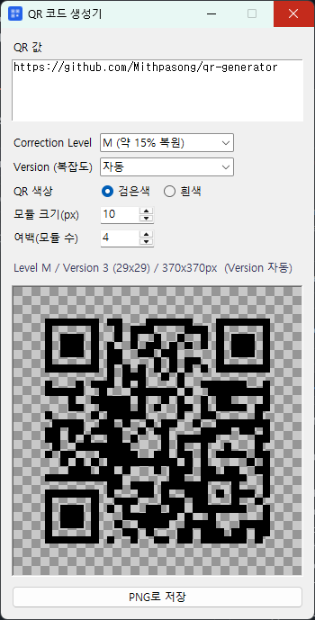

<div align="center">

# QR Generator

**투명 배경 QR 코드 PNG를 만드는 Windows 데스크톱 앱**

텍스트나 URL을 입력하면 바로 미리보고, 배경이 투명한 PNG로 저장합니다.




</div>

---

## ✨ 주요 기능

| 기능 | 설명 |
|---|---|
| 🔲 **투명 배경 PNG** | QR 모듈만 칠하고 나머지는 투명하게 저장해서, 어떤 디자인 위에도 바로 올릴 수 있습니다 |
| 🎨 **색상 선택** | 검은색 / 흰색 QR (흰색은 어두운 배경용) |
| 🛡️ **오류 정정 Level** | L (약 7%) · M (약 15%) · Q (약 25%) 중 선택 |
| 📐 **Version 자동 선택** | 입력 길이에 맞춰 가장 작은 Version을 자동으로 고르거나, 1~40 중 직접 지정 |
| 👀 **실시간 미리보기** | 입력과 옵션을 바꾸면 바로 반영됩니다. 체크무늬 배경으로 투명 영역을 확인할 수 있습니다 |
| 📏 **크기 조절** | 모듈 크기(px)와 여백(모듈 수)을 조절해서 출력 해상도를 맞출 수 있습니다 |

## ⬇️ 다운로드 (Windows)

Python 없이 바로 실행할 수 있는 exe 파일을 제공합니다.

1. [**Releases**](https://github.com/Mithpasong/qr-generator/releases/latest)에서 `QR-generator-vX.X.X-windows.zip`을 받습니다.
2. 압축을 풀고 `QR-generator.exe`를 실행합니다.

> 서명되지 않은 프로그램이라 처음 실행할 때 Windows SmartScreen 경고가 뜰 수 있습니다. **추가 정보 → 실행**을 누르면 됩니다.

## 🚀 소스로 실행하기

Python 3.10 이상이 필요합니다.

```bash
git clone https://github.com/Mithpasong/qr-generator.git
cd qr-generator
pip install -r requirements.txt
python qr_generator.py
```

## 📖 사용법

1. **QR 값**에 텍스트나 URL을 입력합니다.
2. **Correction Level**을 고릅니다. 복원력이 높을수록 QR이 조금 더 촘촘해집니다.
3. **Version**은 보통 `자동`으로 두면 됩니다. 특정 크기로 고정하고 싶을 때만 숫자를 고르세요.
4. **QR 색상**, **모듈 크기**, **여백**을 원하는 대로 바꿉니다.
5. 상태 표시줄에서 실제로 적용된 Level·Version과 이미지 크기를 확인하고 **PNG로 저장**을 누릅니다.

> 💡 **흰색 QR**은 배경이 투명하기 때문에 어두운 배경 위에 올려야 스캔됩니다.
>
> ⚠️ 입력 내용이 고른 Version에 들어가지 않으면 상태 표시줄에 경고가 뜨고 저장할 수 없습니다. Version을 `자동`으로 바꾸거나 Level을 낮춰 보세요.

## 📦 exe로 빌드하기

[PyInstaller](https://pyinstaller.org/)로 Python 없이 실행되는 단일 exe 파일을 만들 수 있습니다.

```bash
pip install pyinstaller
pyinstaller --noconfirm --onefile --windowed --name QR-generator --icon icon.ico --add-data "icon.ico;." qr_generator.py
```

빌드 결과는 `dist/QR-generator.exe`에 생깁니다.

> `icon.ico`는 저장소에 포함되어 있지 않습니다. 원하는 아이콘을 `icon.ico`라는 이름으로 프로젝트 폴더에 넣고 빌드하세요.
> 아이콘 없이 빌드하려면 `--icon icon.ico --add-data "icon.ico;."`를 빼면 됩니다. 이때는 기본 아이콘으로 실행됩니다.

## 🗂️ 프로젝트 구조

```
qr-generator/
├── qr_generator.py     # 앱 전체 (GUI + QR 생성)
├── requirements.txt    # 의존 패키지
├── docs/
│   └── screenshot.png  # README용 실행 화면
└── LICENSE
```

## 🛠️ 사용 기술

- [qrcode](https://github.com/lincolnloop/python-qrcode): QR 코드 데이터 인코딩
- [Pillow](https://python-pillow.org/): 투명 배경 PNG 렌더링과 미리보기
- Tkinter: GUI (Python 기본 포함)

## 📄 License

[MIT License](LICENSE)
